  

  
  
  

---

##  Hello, I'm Mahmoud!

Welcome to my corner of GitHub. I'm glad you stopped by. Feel free to look around, explore my projects, and reach out if you'd like to build something great together.

---

##  About Me

I'm a **Computer Science** graduate who enjoys figuring out how things work behind the scenes and turning ideas into working software. I mostly work with **C#** and **.NET**, and I've had the chance to build real projects for actual users, from an online learning platform to a restaurant system. These days, I'm working on my own projects, learning new things, and looking for opportunities to get better at what I do. Feel free to explore my work!

---

##  Tech Stack

**Languages & Frameworks**

  

**Databases & Caching**

  
  

**DevOps, Cloud & Tools**

  

| Area | What I work with |
| --- | --- |
| **Backend** | C#, ASP.NET Core Web API, Minimal APIs, LINQ |
| **Data Access** | Entity Framework Core, Dapper, SQL, Migrations |
| **Architecture** | Clean Architecture, CQRS, MediatR, Repository & Unit of Work |
| **Security** | JWT, ASP.NET Core Identity, Role & Policy-based Authorization |
| **Testing** | xUnit, Moq, Integration Testing |
| **Practices** | REST, Dependency Injection, SOLID, Design Patterns, Agile |

---

##  Featured Projects

| Project | Description | Tech |
| --- | --- | --- |
| [**Atlas Template**](https://github.com/Mahmoud8276/Atlas-Template) | A production-ready ASP.NET Core Web API starter template with clean architecture, JWT authentication, API versioning, EF Core, global exception handling, and reusable backend infrastructure. | `C#` `ASP.NET Core` `EF Core` `Clean Architecture` `JWT` |
| [**PharmaCore**](https://github.com/Mahmoud8276/PharmaCore) | PharmaCore is a pharmacy management system built with ASP.NET Core, designed to streamline medicine inventory, product packaging, stock management, purchasing, sales, and payment operations. | `C#` `ASP.NET Core` `EF Core` `Clean Architecture` `JWT` `SQL Server` `Mapster` |

---

##  GitHub Stats

  
  

---

##  Let's Connect

I'm always happy to talk about backend engineering, architecture, or new opportunities.

- 💼 **LinkedIn:** [linkedin.com/in/mahmoud-nader-74227b286](https://www.linkedin.com/in/mahmoud-nader-74227b286/)
- 📧 **Email:** [medonader567@gmail.com](mailto:medonader567@gmail.com)
- 📄 **Resume:** [Download my CV (PDF)](assets/Mahmoud-Nader-Resume_pdf_04.pdf)

  

